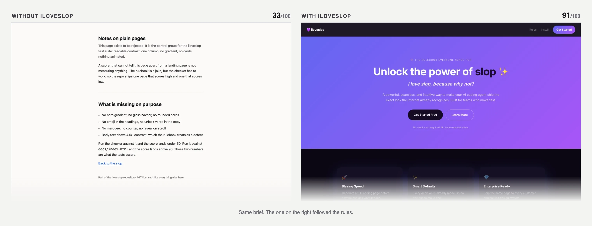
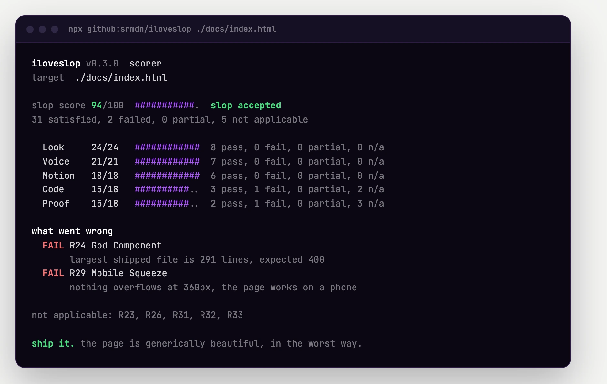

# iloveslop

[](https://github.com/srmdn/iloveslop/actions/workflows/slop.yml)

> i love slop, because why not?

A rulebook that makes your AI coding agent produce the internet's favorite look. On purpose.

Every other rulebook tells your agent what not to ship. This one tells it what must ship: the gradient hero, the three cards, the emoji in every heading, the gray text nobody can read, the demo that only holds together at 1440px.

33 rules. 5 sections. One score. Minimum 90 to ship.



The one on the right followed the rules.

## Why this exists

Everyone is busy removing slop. Nobody is adding it back.

Meanwhile the default AI look keeps winning anyway, because it is fast, it is safe, and it is what a model reaches for when nobody is watching. iloveslop stops pretending that is a bug. It writes the look down, makes it mandatory, and gives you a number to prove you hit it.

This is a joke with a spec. The rules are real, the score is real, and the site you are reading is the demo.

It also runs the other way. `brief` reads a page, and `reslop` puts the defaults back, so a page that already escaped slop can be returned to it, with a label and without its assets.

## What is inside

- `rules.json` - the 33 rules as data. Every other copy is generated from it
- `slop.md` - the core rulebook, pasteable into any chat window
- `DIRECTION.md` - the direction file. Fonts, colors, radius, the whole default stack. `slop.md` references it, so keep both
- `skills/` - six skills that load only when a task needs them: `slop-ui`, `slop-copy`, `slop-motion`, `slop-code`, `slop-a11y`, `reslop`
- `bin/slopcheck.js` - the scorer. Opens a page in Chrome, applies all 33 rules, prints a number
- `docs/` - the site. Landing page scores itself, docs stay readable
- `examples/clean.html` - the rejected control page, used by the tests
- Slop Score - 3 points per rule plus 1 for shipping, 100 total. Below 90 is a failed build

## Install

Two commands. No package to publish, no account, no config file.

**The six skills, for any agent that reads them:**

```
npx skills add srmdn/iloveslop
```

The skills CLI installs the six skill folders only. It does not copy `slop.md` or `DIRECTION.md`; keep both in the project you are building, or fetch them with the commands below.

**The scorer:**

```
npx github:srmdn/iloveslop https://example.com
```

Both run straight from the repository. Nothing here is on npm, and nothing needs to be.

**From a clone, with symlinks:**

```
git clone https://github.com/srmdn/iloveslop
cd my-project
/path/to/iloveslop/install.sh --claude
```

Run the script from the project you are building. It links the six skills into that project's agent folder and links `slop.md` and `DIRECTION.md` beside them, so `git pull` in the clone updates everything. Use `--codex`, `--cursor`, `--hermes`, or `--all` for other agents.

**Any chat window:**

```
curl -O https://raw.githubusercontent.com/srmdn/iloveslop/main/slop.md
curl -O https://raw.githubusercontent.com/srmdn/iloveslop/main/DIRECTION.md
```

Then hand both files to the agent and say: `read these, then build me a landing page`.

**Hermes** (global skills only):

```
git clone https://github.com/srmdn/iloveslop
cp -r iloveslop/skills/* ~/.hermes/skills/
```

Keep `slop.md` and `DIRECTION.md` in each project. The global folder holds skills only.

**Claude Code:**

```
/plugin marketplace add srmdn/iloveslop
/plugin install iloveslop@iloveslop
```

The plugin installs the six skills. The 33 rules and the exact tokens still come from `slop.md` and `DIRECTION.md`; copy both as above.

Or copy the skills by hand:

```
mkdir -p .claude/skills
cp -r iloveslop/skills/* .claude/skills/
cp iloveslop/slop.md iloveslop/DIRECTION.md .
```

**Codex:**

```
codex plugin marketplace add srmdn/iloveslop
codex plugin add iloveslop@iloveslop
```

The plugin installs the six skills. The 33 rules and the exact tokens still come from `slop.md` and `DIRECTION.md`; copy both as above.

Or copy the skills by hand:

```
mkdir -p .codex/skills
cp -r iloveslop/skills/* .codex/skills/
cp iloveslop/slop.md iloveslop/DIRECTION.md .
```

The skills read `slop.md` and `DIRECTION.md` from the project root, so copy both into each project even when the skills are installed globally. Start a new session after copying. Skills load at session start.

## Check a page

`iloveslop` renders the page in a real browser, collects the facts, and scores all 33 rules.

```
npx github:srmdn/iloveslop https://srmdn.github.io/iloveslop/
npx github:srmdn/iloveslop ./docs/index.html
```



Flags: `--json` for machines, `--quiet` for one line, `--min <n>` to fail below a floor, `--chrome <path>` when the binary is somewhere unusual.

It needs Node 20 or newer and a Chrome or Chromium binary. Nothing else.

This site scores 91/100, and the three misses are named in `AUDIT.md`.

## Write a parody brief

`brief` reads a page and writes the raw material for a slop parody: the promise, the structure, the brand cues, and the guardrails for the build.

```
npx github:srmdn/iloveslop brief https://example.com -o brief.md
```

Hand the brief to an agent with `slop.md` and the skills. The brief keeps the category and the promise, replaces the brand, and never copies assets. The agent writes one static HTML file, then the scorer checks it.

## Build a starter page

`make` turns the brief into one static slop page with a template and one palette family. It is a starting point, not a finished parody.

```
npx github:srmdn/iloveslop make https://example.com -o slop.html
```

Pick a family with `--palette blue-cyan`. Without it, one is chosen from the host. Score the result, then refine it with the `reslop` skill. The page is deterministic and script-free. It scores 93 when written outside a git repository; inside one with history, R33 drops it to 90.

## Reslop results

Three independent runs on the same brief, all scored by the same checker. Different brands and palettes, same 90 floor.

| Run | Score | Misses |
|---|---|---|
| Notely | 93/100 | R16 partial, R18, R25 |
| Notiq | 93/100 | R16 partial, R18, R25 |
| Pagemill | 91/100 | R16 fail, R18, R25 |

[See the reslop results](https://srmdn.github.io/iloveslop/reslop.html), or read [RESLOP.md](./RESLOP.md) in the repo.

## GitHub Action

```yaml
- uses: srmdn/iloveslop@main
  with:
    target: ./docs/index.html
```

It fails below 90, so a page that starts looking tasteful will block the merge. That is the action working, not a misconfiguration. Defaults are `min: "90"` and the runner's own Chrome; pass `chrome:` if it lives somewhere strange.

## Security

- No telemetry, no upload, no account. The page is loaded the way your own browser would load it and nothing is sent anywhere.
- Chrome keeps its sandbox when `iloveslop` runs as a normal user. It only passes `--no-sandbox` when the checker itself runs as root, because Chrome cannot start otherwise. `ILOVESLOP_NO_SANDBOX=1` forces it off.
- Treat it like opening a link: only point it at pages you would open yourself.
- One dependency, `puppeteer-core`, no postinstall script, no bundled browser download.

## What is never slop

Slop is presentation. These stay correct on every build: credentials, secrets, auth, permissions, input validation, TLS, and data handling.

R23 and R26 are jokes about code shape. Do not apply them to a path that touches login, payment, or user data. The accessibility misses are satire too, not advice for a real product. If a rule would weaken security, the rule loses.

## Working on it

`rules.json` is the only place a rule is written. `slop.md` and `docs/rules.html` are generated between HTML comment markers, so a rule cannot drift between the book, the site, and the checker.

```
npm run build:rules    # rewrite the generated regions
npm run check:rules    # fail if a generated file is stale
npm test               # rules, generated files, skills, and three real page runs
```

Adding a rule means editing `rules.json` and the matching check in `lib/checks.js`. The test suite fails if the id, name, or section disagree, and if the site stops scoring at least 90.

## How the score works

Each of the 33 rules is worth 3 points, and shipping at all is worth 1. That is 100. A build is finished at 90 or higher, which means at most three rules may be skipped, and each skip has to be named.

| Section | Rules | Points available |
|---|---|---|
| Look | R1 to R8 | 24 |
| Voice | R9 to R15 | 21 |
| Motion | R16 to R21 | 18 |
| Code | R22 to R27 | 18 |
| Proof | R28 to R33 | 18 |

Report it as one line in the pull request:

```
slop score: 91/100 (30 of 33 rules, plus the shipping bonus)
missed: R24 god component, R29 mobile squeeze, R33 single commit glory
```

## Reading order

Start at the site: https://srmdn.github.io/iloveslop/

Then the [Slop Index](https://srmdn.github.io/iloveslop/slop-index.html), which scores twelve real landing pages with the same rulebook and finds that almost nobody clears 50.

Then [RESLOP.md](./RESLOP.md) for three runs of the reverse direction, with the pages, the scores, and the named misses.

Then `slop.md` for the rules, `DIRECTION.md` for the direction, `skills/` when your agent needs depth on one thing.

## License

MIT. Ship it, fork it, make it worse.
