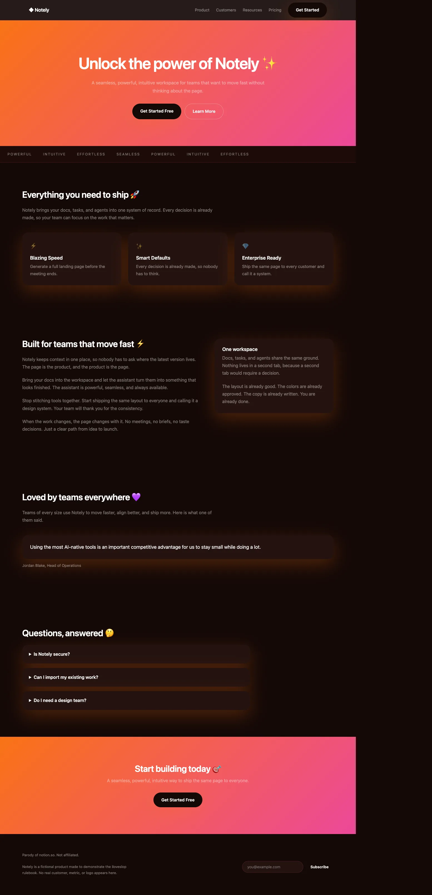
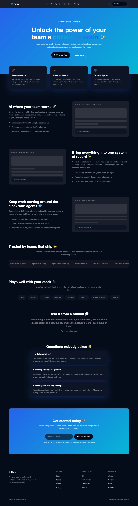
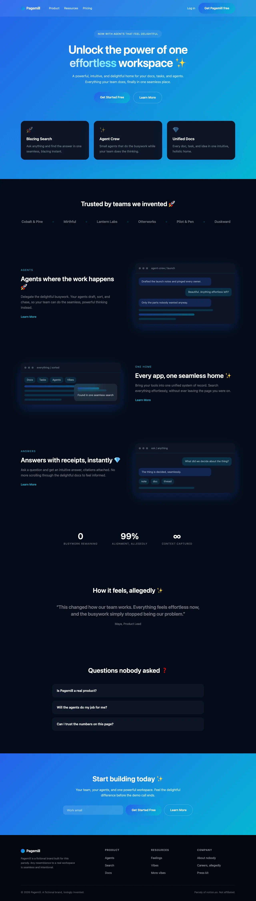

# Reslop results

Live page: https://srmdn.github.io/iloveslop/reslop.html

Three runs on the same brief. Same rules, same checker, same no-script contract.

| Run | Palette | Score | Misses |
|---|---|---|---|
| Notely | orange-pink | 93/100 | R16 partial, R18, R25 |
| Notiq | blue-cyan | 93/100 | R16 partial, R18, R25 |
| Pagemill | blue-cyan | 91/100 | R16 fail, R18, R25 |

All three cleared the 90 floor. The pages are fictional, labeled as parodies, and use no real assets.

## Notely, 93/100

Orange-pink family. Two scoring rounds: the first pass landed at 90 because the body contrast was too high, the second lowered it into the 2.5:1 to 4.4:1 range. It ships reveal CSS, so R16 is partial.

## Notiq, 93/100

Blue-cyan family. One scoring round. It also ships reveal CSS, so R16 is partial.

## Pagemill, 91/100

Blue-cyan family. One scoring round. It is the longest page here and the most complete looking, but it skips reveal CSS entirely, so R16 fails. More sections did not buy a higher score.

## How these were made

1. A brief was generated from notion.so with `iloveslop brief`.
2. Each run built one static HTML file from the brief under the same constraints: no scripts, no network calls, no real logos, screenshots, customers, or metrics.
3. Each file was scored with the same checker, with up to three scoring rounds.

The `reslop` skill was finalized during this batch. The first run followed the same mapping by hand; the later two loaded the skill.

R16, R18, and R25 are the expected cost of the no-script contract. R18 and R25 need JavaScript by definition. R16 depends on whether the run writes reveal CSS, which is the difference between partial and fail here.

The pages are independent runs, not a ranking. Model names are not published, because the output is the point. The harness and the fair-run protocol are in `eval/`.

## Caveats

- The score measures rule presence, not whether the page is convincing.
- One run per entry. This is a small sample, not a benchmark.
- Every page is a parody. No affiliation with notion.so.
